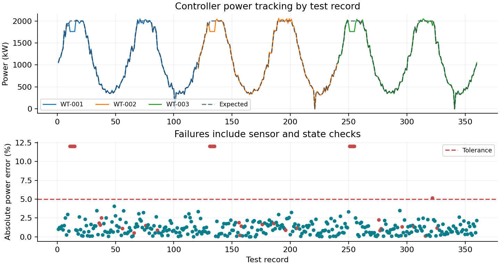
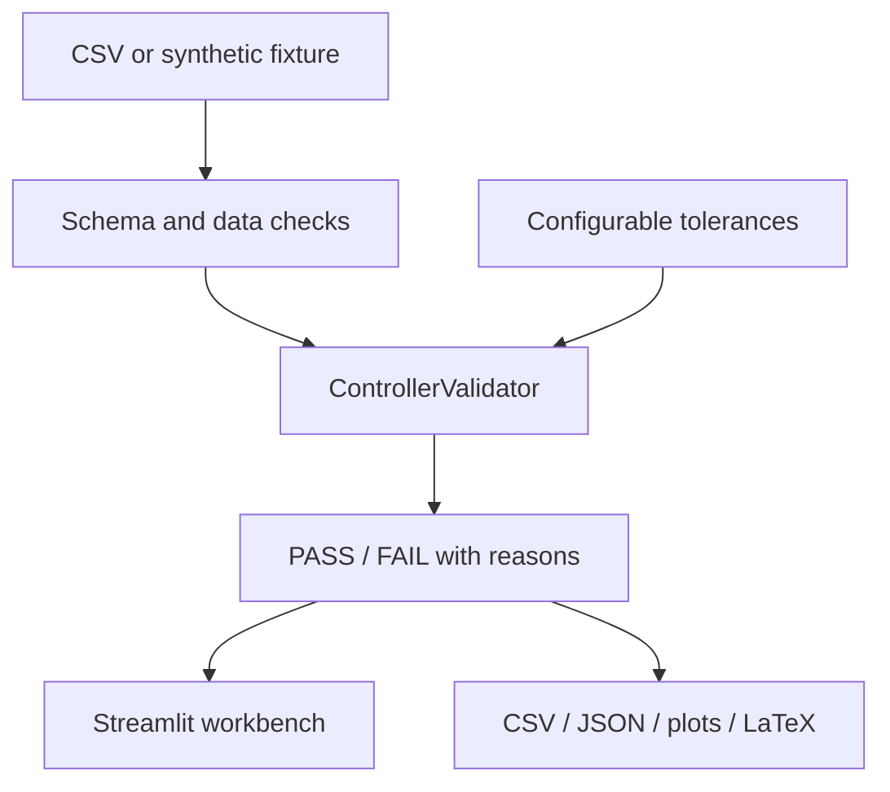

# WindCtrl Validator

**Automated Wind Turbine Controller Validation & Reporting System**

A compact engineering workbench for CSV-based controller test validation. It
checks test data, power-tracking tolerances and operating-state consistency,
then explains failures and produces plots, structured metrics and a LaTeX report.

Independent portfolio project. It was not developed for, commissioned by or
endorsed by Siemens Gamesa. Samples and limits are demonstrations, not certified
manufacturer specifications or real controller telemetry.

## Try the sample

The included fixture has **360 records across three synthetic turbines**. Open
the dashboard, inspect the sample, change tolerances, run validation and filter
failed records. You can also upload a CSV using the same headers. The app provides
results and a downloadable LaTeX report bundle.



## Why this project

Engineering software teams need repeatable evidence that controller outputs match
test expectations. This project demonstrates Python/OOP, data validation, automated
testing, technical reporting and a MATLAB power-check workflow relevant to that work.
It validates individual records; it is not a control simulator or hardware-in-the-loop system.

## Architecture



## Validation contract

- Required columns, numeric finiteness, IDs, timestamps and duplicate records.
- Inclusive demonstration sensor ranges; configurable generator temperature limit.
- `RUNNING` for positive expected demand; `IDLE` or `SHUTDOWN` for zero demand.
- Actual power and controller output are both compared to expected power (kW).
- Default tolerance: ±5%. Example: expected 1800, actual 1760 → 2.22% error → PASS,
  provided the other checks pass.
- Zero expected power uses an absolute 0.5 kW allowance, not a percentage division.
- Invalid sensor rows fail explicitly; missing columns reject the CSV with a clear message.

Percentage-error summaries exclude rows without a valid positive expected power or
valid actual power. Sensor failures are still included if their power values are
valid. The summary exposes its comparable-row count. Maximum deviation in kW also
includes valid zero-demand comparisons. Formula-like uploaded text is escaped in CSV exports.

See [the data contract](data/SCHEMA.md) for exact column names, units and limits.

## Run locally

Python 3.11 or 3.12 is recommended. From this repository's root:

```bash
python -m venv .venv
```

Activate with `.venv\Scripts\Activate.ps1` in Windows PowerShell, or
`source .venv/bin/activate` on macOS/Linux, then:

```bash
python -m pip install -r requirements-dev.txt
python -m pytest
```

Runtime dependencies are specified in `pyproject.toml`. `requirements.txt`
installs the local package; `requirements-dev.txt` also installs test/build tools.
No secrets or paid services are required for local use.

```bash
python -m streamlit run streamlit_app.py
python -m windctrl --input data/controller_samples.csv --output outputs
python -m windctrl --input data/controller_samples.csv --output outputs --tolerance 3
```

For automation, add `--fail-on-validation`: exit code 1 means validation failures;
exit code 2 means input/configuration error. Default successful report generation
returns 0 even when the sample contains intentionally failing records.

## Reports

The CLI writes `validation_results.csv`, `summary.json`, `validation.png` and
`validation_report.tex`. A generated example is committed in [reports/example](reports/example).

If a LaTeX distribution is installed:

```bash
cd outputs
pdflatex -interaction=nonstopmode -halt-on-error validation_report.tex
```

The dashboard does not need LaTeX installed; it downloads source and plot together.
Its results recalculate on each settings change, and the run button explicitly reruns
the current configuration. Uploaded data is processed in memory and is not persisted.

## MATLAB component

`matlab/validate_power.m` implements the meaningful **power-only subset**: finite
input/range validation, inclusive relative tolerance, zero-demand handling and
table output. It is intentionally not presented as parity with all Python checks.
`run_validation.m` reads the sample CSV, writes results and exports a tracking plot.

From the repository root in MATLAB R2020b or newer:

```matlab
addpath('matlab');
results = runtests('matlab/test_validate_power.m');
assertSuccess(results);
run('matlab/run_validation.m');
```

MATLAB execution requires an installed MATLAB runtime/license and is not part of the
Python CI workflow. See `VERIFICATION.md` for what was actually executed.

## Testing and CI

Tests cover normal output, exact tolerance, deviations, missing/negative/non-finite
values, over-temperature, bad states, zero demand, duplicates, malformed CSV, report
escaping and a Streamlit interaction workflow. GitHub Actions runs on Linux
(Python 3.11/3.12) and Windows (3.12), lints, tests, builds and stores JUnit/coverage
evidence and packages. Configuration alone does not establish a passing remote run.

## Deployment

See [DEPLOYMENT.md](DEPLOYMENT.md). Deploy `streamlit_app.py` from the repository root
using Python 3.12. Runtime dependencies and theme are included. No database is needed.

## Reproducibility and limitations

`python scripts/generate_sample.py` regenerates the seeded fixture. A row denotes an
offline test observation; timing, ramps, safety interlocks and dynamic stability are
outside scope. Future work could add scenario-specific state transitions and
hardware-in-the-loop result adapters. No prediction model is included.
